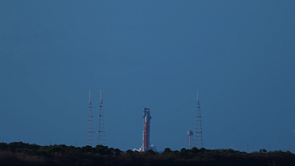

<h1 align="center">Hello, I'm Gustavo Desordi 🎈</h1>

  <em>Computer Science Student • Software Development Enthusiast</em>

---

  

---

  I'm a Computer Science student passionate about technology, software development, and understanding how things work under the hood.

---

### 🧠 About Me

- 🎓 Computer Science student, also pursuing a degree in Systems Analysis and Development
- 💻 Interested in software development and computer systems
- 🐧 Linux enthusiast
- 🔧 Exploring APIs, backend development, and infrastructure
- Always learning, building, and experimenting with new technologies

### 🛠️ Technologies & Tools

**Languages**

  
  
  
  

**Tools & Technologies**

  
  
  
  
  

---

  <em>"You have made us for yourself, O Lord, and our heart is restless until it rests in you."</em>
   
  <strong> — Saint Augustine of Hippo</strong>

